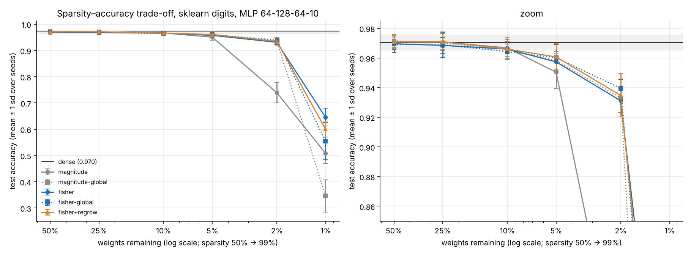
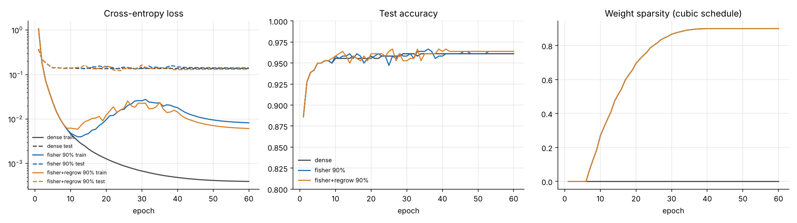

# tinyprune: a self-pruning neural network from scratch (NumPy only)

A reverse-mode autodiff engine, a mask-aware Adam, and an MLP that removes its own
least-important connections during training under a hard sparsity budget, with the
evidence that the result is both sparse and accurate.

```
pip install numpy scikit-learn matplotlib pytest
python -m pytest -q                       # 35 tests, ~3 s
python experiments/run_curves.py          # Part 2 learning curves
python experiments/run_sweep.py           # Part 4 sweep: 310 runs, ~10 min on 2 cores
python experiments/analyze.py             # Pareto plot, summary, paired tests
python experiments/measure_cost.py        # FLOPs / bytes / wall-clock of the sparse path
python experiments/validate_criterion.py  # does each score predict the true loss increase?
python experiments/confirm.py             # headline claim on fresh seeds 10-19 -> results/CLAIM.md
```

**Library use, stated explicitly.** scikit-learn is used **only to load the dataset**
(`sklearn.datasets.load_digits`, and `fetch_openml` for the optional Fashion-MNIST path). It is not
used for splitting, scaling, training, models or gradients. NumPy is the only numerical dependency
of the core; matplotlib is only used to draw plots. No PyTorch / TensorFlow / JAX / autodiff or
pruning library is used anywhere.

**Dataset.** sklearn's bundled 8×8 handwritten digits (1,797 images, 10 classes; 1,438 train /
359 test, stratified split with a fixed seed). I chose it because it runs offline and is small
enough to run **10 seeds per setting**, which is what Part 4's "is the difference real or noise"
needs. `tinyprune.data.load("fashion")` is wired up for Fashion-MNIST but needs internet access
(it was not reachable from the environment this was built in, so no Fashion-MNIST numbers are
reported).

## Headline result

> At **98% sparsity** (340 of 17,024 weights), Fisher self-pruning keeps **92.7%** test accuracy
> vs **74.3%** for magnitude pruning: **+18.4 pp, 10/10 paired seeds, 95% CI [+14.6, +21.8]**,
> on fresh seeds never used during development. Dense: 97.1%.
> **At 90% sparsity there is no advantage**; magnitude is marginally ahead.

Full statement, how to falsify it, and what it does not claim: [`results/CLAIM.md`](results/CLAIM.md).



## Repository map

| file | what it is |
|---|---|
| `tinyprune/tensor.py` | Tensor, all differentiable ops, broadcasting-aware backward, fused stable softmax-CE |
| `tinyprune/gradcheck.py` | central finite-difference gradient checker |
| `tinyprune/nn.py` | masked `Linear`, `MLP`, initialisation |
| `tinyprune/optim.py` | mask-correct `Adam`; `NaiveAdam` kept only to demonstrate the bug in tests |
| `tinyprune/prune.py` | importance criteria, cubic schedule, honest masking, RigL-style regrowth |
| `tinyprune/sparse.py` | structural compaction + CSR forward path, FLOP counting |
| `tinyprune/train.py` | mini-batch training loop, cosine LR |
| `tests/` | gradient checks for every op; masking/optimizer correctness; sparse path equivalence |
| `experiments/` | every number and plot in `results/` is produced by a script here |
| `results/` | raw CSVs, plots, `CLAIM.md`, saved seed-0 models |

---

## Part 1: the autodiff engine

Each `Tensor` holds a float64 array, its parents, and a closure that pushes its gradient into
them. `backward()` builds a topological order **iteratively** (no recursion limit), seeds
dL/dL = 1 and runs the closures in reverse order. Gradients **accumulate** (`+=`), so a tensor
used on several paths gets the sum of all of them (tested: `reuse_accumulation`).

**Broadcasting.** NumPy broadcasts silently in the forward pass, so every op passes its upstream
gradient through `_unbroadcast`, which sums over axes that were prepended or stretched from size 1.
That is why `(N, D) + (D,)` gives the bias a `(D,)` gradient equal to the column sums (tested
directly and by finite differences).

**Stable softmax + cross-entropy** is one fused op: `log p_y = z_y − m − log Σ exp(z − m)` with
`m = max z`, so every `exp` argument is ≤ 0 and the log argument is ≥ 1. Backward is
`(softmax − onehot)/N`. Tested with logits of ±50,000.

**Ops implemented and gradient-checked** (`tests/test_gradcheck.py`, 23 cases, max relative
error < 1e-6): add, sub, mul, div (incl. reflected and negation), matmul, sum (all / axis /
keepdims), mean, ReLU, tanh, sigmoid, softmax-CE, three broadcasting cases, node reuse, and an
end-to-end MLP.

### The masking correctness requirement

A masked layer computes `W_eff = W ⊙ M`, `z = x @ W_eff`, `y = z + b`, with `M` a constant.
"The gradient of a masked weight" has **two** legitimate meanings, and the design keeps them
separate on purpose:

| quantity | value at a pruned entry | used for |
|---|---|---|
| `dL/dW` | **exactly 0** (W has no effect on L) | the optimizer |
| `dL/dW_eff = xᵀδ` | dense, generally non-zero | regrowth scoring only |

The second one is not a bug; it answers "how much would the loss move if this connection
existed?", which is exactly what regrowth needs (tested against finite differences on the
effective weight, including at pruned positions).

The subtle bugs are in the **optimizer**, and `optim.py` documents three:

1. **Ghost momentum.** The masked gradient is 0, but Adam's update uses `m̂/√v̂`. Stale `m` from
   before pruning keeps moving the "pruned" weight for dozens of steps. Hidden from the loss by
   the mask, but the weight is not a real zero and it re-enters with a value nobody chose.
2. **Stale moments on revival.** Reusing old `m`, `v` when a weight is regrown drives it with
   another network's gradient history.
3. **Global bias correction.** Resetting `m = v = 0` on revival but keeping one global step
   counter `t` (say t = 5000) makes the bias correction ≈ 1, so the first step is
   `lr·(1−β₁)g / √((1−β₂)g²) ≈ 3.16·lr`, a 3× spike exactly when the weight is most fragile.

**Fix:** updates, moments and step counts are only touched where the mask is 1; on prune *and*
regrow the entry's `m`, `v` and a **per-entry step counter** are reset and the weight is set to
exactly 0.0, which the optimizer re-asserts after every step. Tests (`tests/test_masking.py`):

* masked weight contributes exactly 0 to the forward pass, even if its stored value is corrupted;
* `dL/dW = 0` and `dL/dW_eff` matches finite differences at pruned positions;
* after pruning, 20 more Adam steps leave pruned weights at exactly 0.0 with zero moments,
  while `NaiveAdam` measurably drifts them away from 0 (**the bug, demonstrated**);
* a pruned-then-regrown weight follows a **brand-new single-parameter Adam's trajectory to
  1e-15**, and its first step has magnitude `lr`, not 3·`lr`;
* the closed-form 3.16× spike of failure mode 3 is asserted;
* after real training runs with every method, all pruned weights and their moments are 0.

## Part 2: training

`MLP([64, 128, 64, 10])`, ReLU, Adam (lr 3e-3 → 1e-4 cosine), batch 64, 60 epochs.

**Initialisation.** Hidden layers use **He** (`Var = 2/fan_in`): ReLU zeroes about half the
pre-activation mass, so doubling the variance keeps activations from shrinking layer by layer.
The logit layer uses **Glorot** (`Var = 2/(fan_in+fan_out)`), giving small initial logits and
an initial loss near ln 10 = 2.30 instead of a confident wrong guess. Biases start at 0.

**Input scaling.** Features are centred per pixel but scaled by **one global** standard
deviation. Per-pixel standardisation was a real bug I hit: border pixels are almost always 0 in
training, so dividing by their tiny std turned a rare test-time ink pixel into |x| ≈ 38.
Fixing it raised dense accuracy from ~95.8% to ~97%.

**Stability.** The loop raises on any non-finite loss; `run_curves.py` additionally asserts every
recorded metric is finite. No NaNs occurred in any of the 400+ runs.



Training loss rises while the cubic ramp removes weights (epochs 6–42) and recovers once the mask
is frozen; test accuracy tracks the dense model throughout. Raw numbers:
`results/learning_curves.csv`.

## Part 3: making it prune itself

### Importance criterion: derivation

Removing weight `wᵢ` is the move `δwᵢ = −wᵢ`. Second-order Taylor expansion of the loss:

```
ΔLᵢ ≈ gᵢ·δwᵢ + ½ Hᵢᵢ δwᵢ²  =  −gᵢwᵢ + ½ Hᵢᵢ wᵢ²          (cross terms Hᵢⱼ dropped: OBD)
```

* **gᵢ** is an EMA of mini-batch gradients (β = 0.95), estimating the full-data gradient.
* **Hᵢᵢ** is approximated by the empirical Fisher `Fᵢᵢ = Eₙ[(∂ℓₙ/∂wᵢ)²]` (Gauss-Newton for
  cross-entropy). It needs **per-sample** gradients; squaring a batch average would shrink F by
  ~1/B. For `z = xW` the per-sample gradient is `xₙ ⊗ δₙ`, so
  `F = (1/B) Σₙ xₙ² ⊗ δₙ² = (1/B)(X²)ᵀ(Δ²)`: **one extra matmul per layer, no per-sample loop**
  (verified against an explicit loop in tests).

**Score used: `½ F wᵢ²` (OBD with Fisher curvature). Why drop the `−g·w` term? Measurement, not
assumption.** `experiments/validate_criterion.py` deletes 600 individual weights and measures the
true loss change, and also removes 50/75/90% of each layer at once:

| criterion | Spearman with true ΔL (single weights, end of training) | one-shot 75% removal: test acc | one-shot 90% |
|---|---|---|---|
| magnitude `|w|` | 0.59 | 87.5% | 40.1% |
| first-order `|g·w|` | 0.79 | 81.3% | 47.9% |
| full Taylor `½Fw² − g·w` | 0.82 | 75.2% | 41.5% |
| **OBD `½Fw²`** | **0.85** | **92.2%** | **66.0%** |

Every gradient-aware score predicts single-weight damage better than magnitude, and early in
training the full Taylor score is best of all (0.87 with oracle statistics). But **pruning removes
many weights at once**, and the first-order terms are not independent: the weights whose removal
"looks helpful" are exactly those where `−wᵢ` points down the gradient, so removing hundreds
together is one large uncontrolled step along the gradient, and the neglected cross terms add up
coherently. `½Fw²` is ≥ 0 for every weight, so its errors don't line up. Near a stationary point
(where gradual pruning keeps re-converging the network) `E[g] ≈ 0` anyway, which is OBD's own
justification.

**Why it should beat magnitude:** magnitude implicitly assumes equal curvature for every weight. A
large weight on a rarely-active input has `F ≈ 0` and costs nothing to remove; a small weight on
a busy input feeding a sensitive unit can be expensive. Fisher scores are also in **loss units**,
so they're comparable across layers, which raw magnitudes are not.

### Schedule

Cubic ramp (Zhu & Gupta 2017): `s(t) = s_f (1 − (1 − (t−t₀)/(t₁−t₀))³)`, from 10% to 70% of
training, masks updated every 10 steps, then 30% of training fine-tuning with a frozen mask. It
prunes fast while the network is redundant and slowly when every weight matters. One-shot pruning
at the end would be cheaper but gives the network no chance to re-route; the table above shows
how much damage one-shot removal does even with a good criterion (66% at 90%, vs 96.6% gradual).

### Honest masking and the hard budget

Pruned weights are set to exactly `0.0`, masked in the graph, and held at zero by the optimizer.
Every run asserts at the end that `W[~mask] == 0` and the achieved sparsity equals the target
(to within rounding, e.g. 0.90002). Biases (202 parameters) are not pruned; sparsity is measured
over the 17,024 weights.

### Regrowth (bonus)

A pruned connection's `dL/dW_eff` is the first-order loss decrease from re-enabling it. Every 100
steps, the lowest-scoring active weights are swapped for the pruned weights with the largest EMA
`|dL/dW_eff|` (RigL-style; 30% swap fraction, cosine-decayed to 0 at 80% of training). **Stability
measures:** regrown weights start at exactly 0 (the network function doesn't jump), get fresh
optimizer state with per-entry bias correction (no 3× step), are protected from removal for one
full swap interval, and swapping stops before training ends so fine-tuning sees a fixed
architecture.

A lesson worth recording: my first version swapped every 10 steps, ~10× RigL's churn. New
zero-initialised weights were judged before they could learn anything and it **cost up to 36 pp**
at 98%. Moving swaps to their own slower clock fixed it. Final effect: small and mostly within
noise (+0.25 pp at 75%, +0.3 pp at 95–98%), and harmful at 99% (−4.5 pp, where every swap
destroys a scarce working connection).

## Part 4: evidence

### 1. Sparsity–accuracy curve (10 seeds each; mean ± sd)

| sparsity | magnitude | magnitude-global | **fisher** | fisher-global | fisher+regrow |
|---|---|---|---|---|---|
| 0% (dense) | 97.05 ± 0.51 | | | | |
| 50% | 97.08 ± 0.44 | 97.16 ± 0.45 | 96.96 ± 0.40 | 96.94 ± 0.54 | 97.10 ± 0.46 |
| 75% | 97.08 ± 0.58 | 97.02 ± 0.74 | 96.85 ± 0.53 | 96.88 ± 0.86 | 97.10 ± 0.53 |
| 90% | 96.69 ± 0.72 | 96.57 ± 0.64 | 96.60 ± 0.49 | 96.43 ± 0.52 | 96.60 ± 0.64 |
| 95% | 95.04 ± 1.10 | 95.82 ± 0.62 | 95.74 ± 0.60 | 96.02 ± 0.89 | 96.07 ± 0.89 |
| 98% | 73.90 ± 3.90 | 93.31 ± 1.27 | 93.12 ± 0.82 | 93.96 ± 0.60 | 93.48 ± 1.46 |
| 99% | 50.86 ± 3.86 | 34.62 ± 6.12 | **64.60 ± 3.39** | 55.46 ± 7.10 | 60.08 ± 3.02 |

Raw: `results/sweep_raw.csv` (one row per run, 310 rows), `results/summary.csv`.

### 2. Real cost

Seed-0 Fisher models, `experiments/measure_cost.py` → `results/cost.csv`. All three paths are
first checked to produce identical logits.

| sparsity | weights kept | shapes after compaction | FLOPs/sample (dense 34,250) | FLOP cut | weight bytes (dense 136 KB) | wall-clock, compacted vs dense (batch 359) |
|---|---|---|---|---|---|---|
| 50% | 8,512 | 64×128, 128×59, 59×10 | 17,221 | 2.0× | 138 KB | 1.04× |
| 90% | 1,700 | 64×98, 98×32, 32×10 | 3,540 | 9.7× | 28 KB | **1.67×** |
| 95% | 845 | 64×70, 70×24, 24×10 | 1,794 | 19.1× | 14 KB | **3.95×** |
| 98% | 306 | 64×42, 42×12, 12×10 | 676 | 50.7× | 5.4 KB | **3.32×** |
| 99% | 149 | 64×32, 32×7, 7×10 | 347 | 98.7× | 2.8 KB | **3.48×** |

Two sparse-aware paths, both written from scratch in `sparse.py`:

* **Structural compaction** (exact): hidden units with no outgoing weights are deleted; units with
  no incoming weights output the constant `relu(b)`, which is folded into the next layer's bias.
  This produces genuinely smaller dense matrices, and **this is where the real wall-clock speedup
  comes from**.
* **CSR forward**: only live weights are stored and multiplied (B·nnz multiply-adds). The FLOP
  counts above are for this path.

**Honesty notes.**
* My NumPy CSR path is **slower** in wall-clock than BLAS at every size here (0.15× at 90%,
  batch 359). The FLOP reduction is real, but on 64×128 matrices the gather and Python overhead
  dominate. On real hardware you'd need a compiled sparse kernel, or (more realistically for
  unstructured sparsity) rely on compaction and memory savings. I report it rather than hide it.
* The "dense-masked" baseline (`X @ (W⊙M)`) is the multiply-by-zeros shortcut and does exactly
  the unpruned amount of work; it counts as zero speedup by construction. (An earlier version of
  my benchmark re-applied the mask inside the timed call, which flattered the sparse path; fixed.)
* Timing noise: the dense model run through the compacted path (identical work) measures
  0.79–1.15×, so differences under ~20% are not meaningful.

### 3. Baseline comparison and variance

Every method with the same seed shares the init, the batch order and the test set, so
comparisons are **paired**. For each pair I report the mean difference, a 20k-resample bootstrap
CI, wins/ties/losses, and an **exact** sign-flip permutation test over all 2¹⁰ sign patterns (no
normality assumption; the smallest attainable p with 10 seeds is 0.002).
Full table: `results/sweep_report.md`, `results/paired_tests.csv`.

| fisher − magnitude (layerwise) | mean (pp) | 95% CI | W/T/L | p |
|---|---|---|---|---|
| 50% | −0.11 | [−0.42, +0.20] | 4/1/5 | 0.62 |
| 75% | −0.22 | [−0.47, +0.03] | 2/2/6 | 0.20 |
| 90% | −0.08 | [−0.50, +0.39] | 3/2/5 | 0.82 |
| 95% | +0.70 | [+0.22, +1.14] | 8/1/1 | 0.035 |
| 98% | **+19.22** | [+17.05, +21.50] | 10/0/0 | 0.002 |
| 99% | **+13.73** | [+11.34, +16.10] | 10/0/0 | 0.002 |

**Reading it honestly:**
* Up to 90%, this network has so much slack that **which** weights you remove barely matters; the
  gap is noise (and seed-to-seed sd is 0.5–0.7 pp, i.e. 2 test images).
* From 95% on, Fisher wins, and the win becomes very large at 98–99%.
* **Allocation matters as much as the criterion.** Global magnitude (ranking all layers together)
  matches layerwise Fisher up to 98%. Uniform-per-layer magnitude fails at 98% because it treats
  the 64×10 output layer like the 64×128 input layer. Fisher-layerwise is the only method that is
  robust everywhere, and it is the only one that holds up at 99% (64.6% vs 50.9% / 34.6%).

### 4. Falsifiable claim

See [`results/CLAIM.md`](results/CLAIM.md). The 98% advantage was first seen in a 4-seed pilot,
so to avoid claiming something I went looking for, it was **re-tested on seeds 10–19, never run
during development**, with every setting frozen: +18.4 pp, CI [+14.6, +21.8], 10/10 seeds. On the
same fresh seeds the 90% result is −0.28 pp (magnitude marginally ahead). Both are in the claim.

## Limitations

* One small dataset and one architecture. Digits is easy: a 98%-sparse MLP still reaches 93%.
  The Fashion-MNIST path exists but wasn't run here.
* The test set has 359 images (1 image = 0.28 pp). Seeds vary init and batch order but the split
  is fixed, so variance from the choice of split is not captured.
* Hyper-parameters (lr, schedule, EMA, swap cadence) were set on seeds 0–3 and the same test
  split used for reporting; the fresh-seed confirmation guards against seed-picking but not
  against split overfitting. A held-out validation split would be the next step.
* Empirical Fisher (true labels) rather than the true Fisher (labels sampled from the model).
* Unstructured sparsity only; the wall-clock gain comes from units that become fully disconnected.
